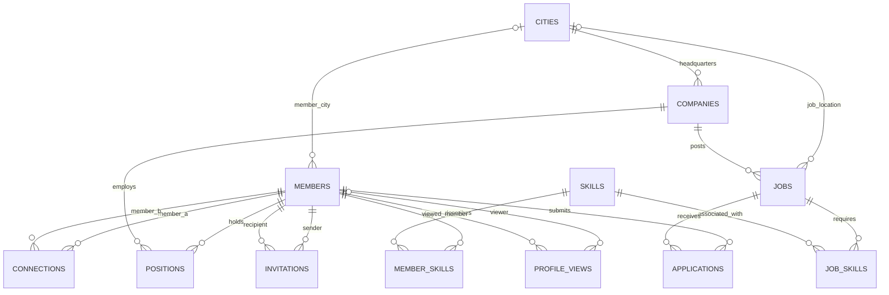

# Schema Design

## 1. Database Overview

The project uses PostgreSQL 15+ and the `linkedin` schema to manage a professional networking platform. The database contains 12 tables covering members, companies, jobs, skills, connections, invitations, applications, and profile views.

The schema uses primary keys, foreign keys, `NOT NULL`, and `CHECK` constraints to maintain data integrity. Primary keys also ensure uniqueness of records.

## 2. Data Dictionary

### 2.1 cities

| Column | Data Type | Constraints | Description |
|---|---|---|---|
| city_id | INTEGER | PK, NOT NULL | Unique city identifier |
| city_name | TEXT | NOT NULL | City name |
| state | TEXT | NOT NULL | State name |

### 2.2 companies

| Column | Data Type | Constraints | Description |
|---|---|---|---|
| company_id | INTEGER | PK, NOT NULL | Unique company identifier |
| company_name | TEXT | NOT NULL | Company name |
| industry | TEXT | NOT NULL, CHECK | Company industry |
| company_size | TEXT | NOT NULL, CHECK | Company size category |
| hq_city_id | INTEGER | FK, NOT NULL | Headquarters city |
| founded_year | INTEGER | NOT NULL | Year company was founded |
| website | TEXT | NULL allowed | Company website |

### 2.3 members

| Column | Data Type | Constraints | Description |
|---|---|---|---|
| member_id | INTEGER | PK, NOT NULL | Unique member identifier |
| first_name | TEXT | NOT NULL | Member's first name |
| last_name | TEXT | NOT NULL | Member's last name |
| headline | TEXT | NULL allowed | Professional headline |
| email | TEXT | NOT NULL | Member's email |
| city_id | INTEGER | FK, NULL allowed | Member's city |
| industry | TEXT | NOT NULL, CHECK | Member's industry |
| is_premium | BOOLEAN | NOT NULL | Premium membership status |
| open_to_work | BOOLEAN | NOT NULL | Job-seeking status |
| created_at | TIMESTAMPTZ | NOT NULL | Account creation time |

### 2.4 skills

| Column | Data Type | Constraints | Description |
|---|---|---|---|
| skill_id | INTEGER | PK, NOT NULL | Unique skill identifier |
| skill_name | TEXT | NOT NULL | Skill name |

### 2.5 positions

| Column | Data Type | Constraints | Description |
|---|---|---|---|
| position_id | INTEGER | PK, NOT NULL | Unique position identifier |
| member_id | INTEGER | FK, NOT NULL | Member holding the position |
| company_id | INTEGER | FK, NOT NULL | Associated company |
| title | TEXT | NOT NULL | Job title |
| employment_type | TEXT | NOT NULL, CHECK | Type of employment |
| start_date | DATE | NOT NULL | Employment start date |
| end_date | DATE | NULL allowed | Employment end date |

### 2.6 member_skills

| Column | Data Type | Constraints | Description |
|---|---|---|---|
| member_id | INTEGER | PK, FK, NOT NULL | Associated member |
| skill_id | INTEGER | PK, FK, NOT NULL | Associated skill |
| endorsements | INTEGER | NOT NULL, CHECK (endorsements >= 0) | Number of endorsements |

The composite primary key is `(member_id, skill_id)`.

### 2.7 connections

| Column | Data Type | Constraints | Description |
|---|---|---|---|
| member_a | INTEGER | PK, FK, NOT NULL | First member |
| member_b | INTEGER | PK, FK, NOT NULL | Second member |
| connected_at | TIMESTAMPTZ | NOT NULL | Connection creation time |

The composite primary key is `(member_a, member_b)`.

### 2.8 invitations

| Column | Data Type | Constraints | Description |
|---|---|---|---|
| invitation_id | INTEGER | PK, NOT NULL | Unique invitation identifier |
| sender_id | INTEGER | FK, NOT NULL | Member sending invitation |
| recipient_id | INTEGER | FK, NOT NULL | Member receiving invitation |
| note | TEXT | NULL allowed | Invitation message |
| sent_at | TIMESTAMPTZ | NOT NULL | Invitation sending time |
| status | TEXT | NOT NULL, CHECK | Invitation status |
| responded_at | TIMESTAMPTZ | NULL allowed | Response time |

### 2.9 jobs

| Column | Data Type | Constraints | Description |
|---|---|---|---|
| job_id | INTEGER | PK, NOT NULL | Unique job identifier |
| company_id | INTEGER | FK, NOT NULL | Hiring company |
| title | TEXT | NOT NULL | Job title |
| city_id | INTEGER | FK, NULL allowed | Job location |
| workplace_type | TEXT | NOT NULL, CHECK | Remote, onsite, or hybrid |
| employment_type | TEXT | NOT NULL, CHECK | Employment category |
| min_experience | INTEGER | NOT NULL, CHECK (min_experience >= 0) | Minimum experience required |
| min_salary_lpa | NUMERIC(10,2) | NULL allowed, CHECK (>= 0) | Minimum salary |
| max_salary_lpa | NUMERIC(10,2) | NULL allowed, CHECK (>= 0) | Maximum salary |
| posted_at | TIMESTAMPTZ | NOT NULL | Job posting time |
| closes_at | TIMESTAMPTZ | NOT NULL | Job closing time |
| status | TEXT | NOT NULL, CHECK | Job status |

An additional CHECK constraint ensures that `min_salary_lpa` does not exceed `max_salary_lpa` when both values are provided.

### 2.10 job_skills

| Column | Data Type | Constraints | Description |
|---|---|---|---|
| job_id | INTEGER | PK, FK, NOT NULL | Associated job |
| skill_id | INTEGER | PK, FK, NOT NULL | Required skill |

The composite primary key is `(job_id, skill_id)`.

### 2.11 applications

| Column | Data Type | Constraints | Description |
|---|---|---|---|
| application_id | INTEGER | PK, NOT NULL | Unique application identifier |
| job_id | INTEGER | FK, NOT NULL | Applied job |
| member_id | INTEGER | FK, NOT NULL | Applicant |
| applied_at | TIMESTAMPTZ | NOT NULL | Application time |
| easy_apply | BOOLEAN | NOT NULL | Easy Apply indicator |
| status | TEXT | NOT NULL, CHECK | Application status |
| status_updated_at | TIMESTAMPTZ | NOT NULL | Last status update time |

### 2.12 profile_views

| Column | Data Type | Constraints | Description |
|---|---|---|---|
| view_id | INTEGER | PK, NOT NULL | Unique profile view identifier |
| viewer_id | INTEGER | FK, NULL allowed | Member viewing the profile |
| viewed_id | INTEGER | FK, NOT NULL | Member whose profile was viewed |
| viewed_at | TIMESTAMPTZ | NOT NULL | Profile view time |

## 3. Entity Relationship Diagram

The `member_skills` and `job_skills` tables resolve many-to-many relationships between members and skills, and jobs and skills, respectively. The `connections` table represents relationships between members.

## 4. Functional Dependencies and Normalization

The primary functional dependencies for the database are:

| Table | Functional Dependency |
|---|---|
| cities | city_id → city_name, state |
| companies | company_id → company_name, industry, company_size, hq_city_id, founded_year, website |
| members | member_id → first_name, last_name, headline, email, city_id, industry, is_premium, open_to_work, created_at |
| skills | skill_id → skill_name |
| positions | position_id → member_id, company_id, title, employment_type, start_date, end_date |
| member_skills | (member_id, skill_id) → endorsements |
| connections | (member_a, member_b) → connected_at |
| invitations | invitation_id → sender_id, recipient_id, note, sent_at, status, responded_at |
| jobs | job_id → company_id, title, city_id, workplace_type, employment_type, min_experience, min_salary_lpa, max_salary_lpa, posted_at, closes_at, status |
| job_skills | (job_id, skill_id) → No non-key attributes |
| applications | application_id → job_id, member_id, applied_at, easy_apply, status, status_updated_at |
| profile_views | view_id → viewer_id, viewed_id, viewed_at |

### Normalization

**First Normal Form (1NF):** All tables contain atomic attribute values, and each record can be uniquely identified by its primary key.

**Second Normal Form (2NF):** Every table is in 1NF. Non-key attributes depend on the entire primary key. This is especially relevant to the composite-key tables `member_skills`, `connections`, and `job_skills`.

**Third Normal Form (3NF):** Based on the identified functional dependencies, non-key attributes depend on their table's candidate key and do not have transitive dependencies on other non-key attributes. Separate tables for cities, skills, companies, members, and jobs reduce unnecessary duplication and update anomalies.

## 5. Integrity Checks

After importing the seed data, the following integrity checks were performed:

| Integrity Check | Issues Found |
|---|---:|
| Positions with end date before start date | 0 |
| Jobs closing before posting date | 0 |
| Connections between the same member | 0 |
| Invitations where sender equals recipient | 0 |
| Applications updated before application time | 0 |

All five checks returned zero issues.

### Data Import Verification

All 12 CSV files were successfully imported.

| Table | Imported Rows |
|---|---:|
| cities | 10 |
| skills | 72 |
| companies | 2,000 |
| members | 40,000 |
| positions | 99,940 |
| member_skills | 212,417 |
| connections | 219,966 |
| invitations | 60,000 |
| jobs | 15,000 |
| job_skills | 65,719 |
| applications | 149,984 |
| profile_views | 199,996 |
| **Total** | **1,065,104** |

Primary key and foreign key validation performed before import found no duplicate or missing primary keys and no invalid foreign key references.

## 6. Data Issues and Observations

The following nullable fields were identified in the seed data:

| Table | Column | NULL Rows |
|---|---|---:|
| companies | website | 400 |
| members | headline | 5,946 |
| members | city_id | 1,231 |
| positions | end_date | 34,238 |
| invitations | note | 45,168 |
| invitations | responded_at | 3,098 |
| jobs | city_id | 2,217 |
| jobs | min_salary_lpa | 6,065 |
| jobs | max_salary_lpa | 8,210 |
| profile_views | viewer_id | 50,173 |

These columns were kept nullable to preserve the supplied data. A missing position end date can represent an ongoing position, while a missing profile viewer can represent a private-mode profile view.

No seed data rows were removed or modified during import.